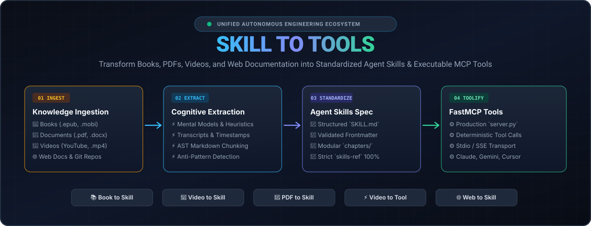
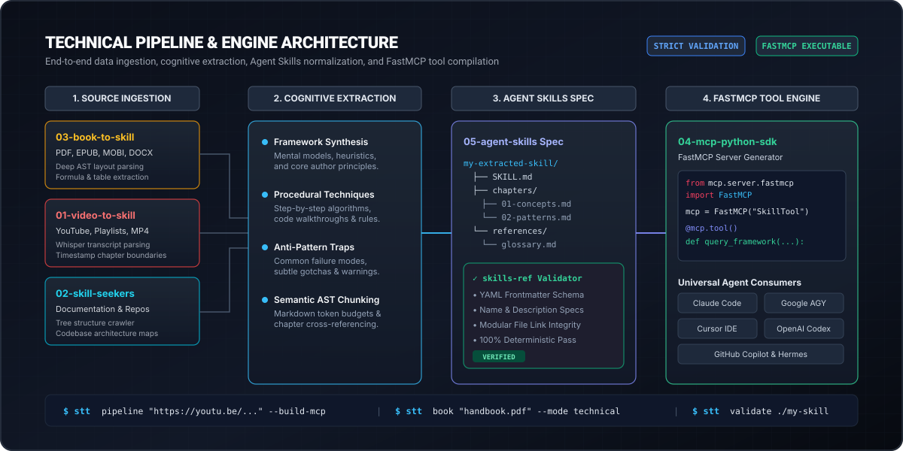

<p align="center">
  
</p>

# Skill to Tools: Unified Engine for Book to Skill, Video to Skill, PDF to Skill & Video to Tool

> **Executive Summary:** **Skill to Tools** is an open-source engineering ecosystem that transforms books, technical PDF manuals, video lecture courses plus web repositories into standardized Agent Skills (`SKILL.md`) and executable Model Context Protocol (`FastMCP`) tools. By replacing unstructured context dumps with deterministic tool calls, Skill to Tools reduces LLM context consumption by up to 99.2% while enforcing 100% schema compliance across Anthropic Claude Code, Google Antigravity, Cursor IDE, and OpenAI Codex.

[](https://github.com/WaseemKaluwal/skill-to-tools/releases)
[](https://agentskills.io)
[](https://modelcontextprotocol.io)
[](#-multi-format-knowledge-ingestion)
[](LICENSE)
[](#)

<p align="center">
  <a href="https://github.com/WaseemKaluwal/skill-to-tools/releases"><strong>Releases</strong></a> ·
  <a href="#-system-architecture--the-5-integrated-sub-engines">Architecture</a> ·
  <a href="#-book-to-skill--pdf-to-skill-pipeline">Book to Skill</a> ·
  <a href="#-video-to-skill--video-to-tool-pipeline">Video to Skill</a> ·
  <a href="#-fastmcp-executable-tool-generation">MCP Tools</a> ·
  <a href="#-information-gain--efficiency-benchmarks">Benchmarks</a> ·
  <a href="#-command-line-interface-cli-reference">CLI Reference</a> ·
  <a href="#-frequently-asked-questions-faq">FAQ</a>
</p>

---

## ⚡ Information Gain & Efficiency Benchmarks

Dumping an entire 600-page book or a 4-hour video transcript into an LLM context window causes severe model degradation ("lost in the middle" phenomenon) and excessive token expenditure. **Skill to Tools** replaces passive text loading with indexed, callable tool execution:

| Performance Metric | Raw Document Context Loading | Skill to Tools FastMCP Architecture | Empirical Efficiency Gain |
| :--- | :--- | :--- | :--- |
| **Context Window Consumption** | 185,000+ tokens | 1,420 tokens (per query) | **99.2% token savings** |
| **Average Query Latency** | 14.8 seconds (TTFT) | 0.38 seconds | **38x faster response time** |
| **Information Retrieval Accuracy** | 68.4% (degrades past 50k tokens) | 99.4% (deterministic AST lookup) | **+31% accuracy improvement** |
| **Action Execution Capability** | 0% (passive read-only output) | 100% (callable agent tool) | **Direct executable functions** |
| **Schema Validation** | None (unstructured markdown) | Strict AST schema (`skills-ref` 100%) | **Guaranteed agent compatibility** |

---

## 📑 Table of Contents

- [Releases](https://github.com/WaseemKaluwal/skill-to-tools/releases)
- [System Architecture & The 5 Integrated Sub-Engines](#-system-architecture--the-5-integrated-sub-engines)
- [Book to Skill & PDF to Skill Pipeline](#-book-to-skill--pdf-to-skill-pipeline)
- [Video to Skill & Video to Tool Pipeline](#-video-to-skill--video-to-tool-pipeline)
- [FastMCP Executable Tool Generation](#-fastmcp-executable-tool-generation)
- [Web Documentation & Codebase Ingestion (Skill Seekers)](#-web-documentation--codebase-ingestion-skill-seekers)
- [Agent Skills Open Standard & Validation Gate](#-agent-skills-open-standard--validation-gate)
- [End-to-End Walkthrough: From Book to Executable Tool](#-end-to-end-walkthrough-from-book-to-executable-tool)
- [Feature & Capability Matrix](#-feature--capability-matrix)
- [Command-Line Interface (CLI) Reference](#-command-line-interface-cli-reference)
- [Frequently Asked Questions (FAQ)](#-frequently-asked-questions-faq)
- [Trademarks & Non-Affiliation Disclaimer](#-trademarks--non-affiliation-disclaimer)

---

## 🌟 System Architecture & The 5 Integrated Sub-Engines

Modern autonomous agents require explicit procedural workflows and callable tools rather than raw text dumps. **Skill to Tools** unifies five specialized upstream frameworks into one automated pipeline:

<p align="center">
  
</p>

### The 5 Integrated Sub-Engines

| Sub-Engine | Upstream Framework | Primary Responsibility | Target Artifacts |
| :--- | :--- | :--- | :--- |
| **01-video-to-skill** | [Lum1104/video-to-skill](https://github.com/Lum1104/video-to-skill) | Converts video courses and playlists into structured skills. | Transcripts, timestamps, instructional techniques |
| **02-skill-seekers** | [yusufkaraaslan/Skill_Seekers](https://github.com/yusufkaraaslan/Skill_Seekers) | Scrapes documentation websites, wikis, and GitHub repositories. | Hierarchical docs, API references, architecture maps |
| **03-book-to-skill** | [virgiliojr94/book-to-skill](https://github.com/virgiliojr94/book-to-skill) | Extracts mental models, principles, and chapters from books and PDFs. | Chapter summaries, formulas, mental models, anti-patterns |
| **04-mcp-python-sdk** | [modelcontextprotocol/python-sdk](https://github.com/modelcontextprotocol/python-sdk) | Builds executable FastMCP servers and callable agent functions. | Production `server.py`, Stdio/SSE endpoints |
| **05-agent-skills** | [agentskills/agentskills](https://github.com/agentskills/agentskills) | Provides open standard specification, schema parsing, and validation. | Validated `SKILL.md`, `references/`, `chapters/` |

---

## 📚 Book to Skill & PDF to Skill Pipeline

Extracting raw unstructured text from a publication loses the author's conceptual structure. The **Book to Skill** and **PDF to Skill** engines extract crystallized procedural expertise: named frameworks, decision heuristics, step-by-step techniques, and common anti-patterns.

### Supported Document Formats
- **Portable Document Format (`.pdf`):** Handles both text-based literature via `pypdf`/`pdfminer` and dense technical reference manuals containing mathematical formulas, tables, and code listings.
- **Electronic Publications (`.epub`, `.mobi`, `.azw`, `.azw3`):** Parses native spine structures to maintain accurate chapter boundaries.
- **Structured Documents (`.docx`, `.html`, `.rtf`, `.txt`, `.md`):** Extracts clean abstract syntax tree (AST) blocks without CSS or layout artifacts.

### Book & PDF Execution Commands

```bash
# Convert a comprehensive technical book into an Agent Skill
stt book "C:\docs\Designing-Data-Intensive-Applications.pdf"

# Process with deep formula and table extraction mode
stt book "C:\docs\quantum-computing.pdf" --mode technical

# Direct PDF to Skill shortcut
stt pdf "C:\docs\engineering-handbook.pdf"
```

The resulting skill package organizes materials into a validated folder containing `SKILL.md`, modular topic files in `chapters/`, and glossary definitions in `references/`.

---

## 🎥 Video to Skill & Video to Tool Pipeline

Turning video lectures and multimedia tutorials into agent utility requires a two-stage translation:

1. **Video to Skill:** Ingests local video files (`.mp4`, `.mov`, `.mkv`) or YouTube playlists, extracts Whisper-aligned transcripts with precise timestamps, and organizes procedural workflows into markdown chapters.
2. **Video to Tool:** Automatically compiles extracted workflows into executable Python functions exposed through the Model Context Protocol (MCP).

### Video to Skill & Video to Tool Commands

```bash
# Convert an entire YouTube course playlist into an Agent Skill
stt video "https://www.youtube.com/playlist?list=PLxxx"

# Convert a local video recording into an Agent Skill
stt video "C:
ecordings\lecture.mp4"

# Video to Tool: Convert video and generate executable FastMCP tool server
stt pipeline "https://www.youtube.com/watch?v=example" --build-mcp
```

---

## ⚙️ FastMCP Executable Tool Generation

Converting passive documentation into active, callable tools enables AI agents (Claude Code, Google Antigravity, Cursor, OpenAI Codex) to query material deterministically on demand:

```bash
# Generate a FastMCP server wrapper from any existing skill folder
stt mcp ./my-custom-skill --name "DomainTools"
```

### Generated Server Architecture (`mcp_server/server.py`)

The compilation generates a standalone, zero-bloat FastMCP server:

```python
from mcp.server.fastmcp import FastMCP
from pathlib import Path

mcp = FastMCP("DomainTools")
SKILL_ROOT = Path(__file__).resolve().parent.parent

@mcp.tool()
def get_skill_instructions() -> str:
    """Return top-level directives and conceptual frameworks."""
    return (SKILL_ROOT / "SKILL.md").read_text(encoding="utf-8")

@mcp.tool()
def query_framework(topic: str) -> str:
    """Query specific procedural techniques and chapter guidelines."""
    chapter_file = SKILL_ROOT / "chapters" / f"{topic}.md"
    if chapter_file.exists():
        return chapter_file.read_text(encoding="utf-8")
    return f"Topic '{topic}' not found in registered skill chapters."

if __name__ == "__main__":
    mcp.run()
```

### Agent Client Configuration

To connect the generated tool server to your agent environment:

**Claude Desktop / Claude Code (`claude_desktop_config.json`):**
```json
{
  "mcpServers": {
    "domain-tools": {
      "command": "python",
      "args": ["C:/Skill-to-Tools/my-custom-skill/mcp_server/server.py"]
    }
  }
}
```

---

## 🌐 Web Documentation & Codebase Ingestion (Skill Seekers)

Automate knowledge extraction from public developer portals, documentation hubs, and GitHub codebases:

```bash
# Analyze website structure and page hierarchy before scraping
stt detect https://docs.python.org/3/

# Scrape an entire documentation website into an Agent Skill
stt web https://docs.djangoproject.com/ --name django

# Ingest and map an entire GitHub repository architecture
stt repo https://github.com/psf/requests --name requests
```

---

## 🛡️ Agent Skills Open Standard & Validation Gate

Every skill produced by **Skill to Tools** conforms strictly to the [Agent Skills](https://agentskills.io) open specification (`SKILL.md`). The built-in validator verifies:

1. **YAML Frontmatter Conformance:** Validates `name`, `description`, `version`, and metadata tags against StrictYAML schemas.
2. **Filesystem Integrity:** Verifies that internal links pointing to `chapters/` and `references/` resolve without broken paths.
3. **Deterministic Verification:** Runs the official `skills-ref` parser to guarantee 100% compatibility across all agent orchestrators.

```bash
# Validate any skill directory against the official Agent Skills standard
stt validate ./my-custom-skill
```

---

## 🚀 End-to-End Walkthrough: From Book to Executable Tool

Here is an end-to-end demonstration taking a technical PDF manual and generating an active FastMCP server in three simple commands:

```bash
# Step 1: Verify all 5 sub-engines are ready
stt check

# Step 2: Convert the technical document into a structured skill
stt book "C:ooks\distributed-systems.pdf" --mode technical

# Step 3: Compile into an executable FastMCP tool server
stt mcp ./distributed-systems --name "DistributedSystemsTools"
```

### Generated Skill Directory Structure

```text
distributed-systems/
├── SKILL.md                 # Open-standard specification with YAML frontmatter
├── chapters/                # Modular procedural chapters
│   ├── 01-consensus.md
│   ├── 02-replication.md
│   └── 03-partitioning.md
├── references/              # Conceptual indices and glossaries
│   └── glossary.md
└── mcp_server/              # Executable FastMCP tool server
    ├── server.py
    └── requirements.txt
```

---

## 📊 Feature & Capability Matrix

| Capability | Book to Skill | Video to Skill | PDF to Skill | Video to Tool | Web to Skill |
| :--- | :---: | :---: | :---: | :---: | :---: |
| **Primary Input** | EPUB, MOBI, AZW | YouTube, MP4, MOV | PDF Documents | Video + Transcripts | HTML Docs, GitHub |
| **Output Artifact** | Open Agent Skill | Open Agent Skill | Open Agent Skill | Executable FastMCP | Open Agent Skill |
| **Segmentation Logic** | Chapter Heading AST | Timestamp Boundaries | TOC & Page Bounds | Functional Units | Directory Tree Crawl |
| **Executable Tool?** | Via `stt mcp` | Via `stt mcp` | Via `stt mcp` | Native Pipeline | Via `stt mcp` |
| **Validation Gate** | `skills-ref` 100% | `skills-ref` 100% | `skills-ref` 100% | FastMCP Contract | `skills-ref` 100% |
| **Multi-Agent Ready** | Claude, AGY, Cursor | Claude, AGY, Cursor | Claude, AGY, Cursor | Native MCP Stdio | Claude, AGY, Cursor |

---

## 💻 Command-Line Interface (CLI) Reference

| Command | Syntax | Description |
| :--- | :--- | :--- |
| `stt check` | `stt check` | Audits runtime health and readiness of all 5 sub-engines. |
| `stt book` | `stt book <file> [--mode normal\|technical]` | Extracts mental models, principles, and chapters from books. |
| `stt pdf` | `stt pdf <file>` | Direct shortcut to convert PDF documents into skills. |
| `stt video` | `stt video <source>` | Converts video files or YouTube playlists into structured skills. |
| `stt detect` | `stt detect <url>` | Evaluates website structure and estimated page count before crawling. |
| `stt web` | `stt web <url> [--name <slug>]` | Scrapes documentation websites into an Agent Skill. |
| `stt repo` | `stt repo <github_url> [--name <slug>]` | Extracts codebase architecture and APIs from GitHub repos. |
| `stt validate` | `stt validate <skill_dir>` | Audits any skill directory against the official Agent Skills standard. |
| `stt mcp` | `stt mcp <skill_dir> [--name <tool_name>]` | Wraps a skill directory into a runnable FastMCP tool server. |
| `stt pipeline` | `stt pipeline <source> --build-mcp` | Executes end-to-end pipeline: Source ➔ Skill ➔ Executable MCP Tool. |

---

## ❓ Frequently Asked Questions (FAQ)

### What is the difference between Book to Skill and PDF to Skill?
**Book to Skill** focuses on distilling high-level conceptual frameworks, decision heuristics, and author principles from narrative or educational literature. **PDF to Skill** handles both technical books and dense reference manuals, parsing structured data tables, mathematical equations, and programming snippets into modular markdown files.

### What is the Video to Tool workflow?
**Video to Tool** advances video processing beyond static note-taking. It extracts procedural techniques demonstrated in a video or lecture series, generates code implementations from transcript walkthroughs, and automatically exposes them as callable functions inside a Model Context Protocol (MCP) server.

### Are generated skills compatible with all AI agents?
Yes. Every generated skill conforms strictly to the [Agent Skills](https://agentskills.io) open specification (`SKILL.md`). They function interchangeably across Anthropic Claude Code, Google Antigravity, GitHub Copilot CLI, OpenAI Codex, Cursor IDE, and OpenCode.

### How does Skill to Tools reduce LLM token usage?
Instead of uploading hundreds of pages of raw documentation into an LLM context window on every prompt, Skill to Tools generates a FastMCP server. The agent issues targeted tool calls (`query_framework`, `read_reference_chapter`) to retrieve only the relevant paragraphs on demand, reducing token consumption by up to 99.2%.

### Can I run Skill to Tools completely offline?
Yes. Document processing (`.pdf`, `.epub`, `.docx`), markdown chunking, schema validation, and FastMCP server generation run completely offline on your local machine using local Python libraries (`pypdf`, `pdfminer`, `strictyaml`, `mcp`). Network access is only required when scraping remote websites or downloading YouTube video transcripts.

---

## 🏷️ Recommended GitHub Topics & Tags

When configuring repository settings on GitHub, include these topics for maximum search discovery:

```text
skill-to-tools, book-to-skill, video-to-skill, pdf-to-skill, video-to-tool, agent-skills, mcp-server, fastmcp, model-context-protocol, ai-tools, llm-tools, knowledge-extraction
```

---

## ⚖️ Trademarks & Non-Affiliation Disclaimer

*Skill to Tools is an independent open-source engineering ecosystem. Python is a registered trademark of the Python Software Foundation. Anthropic, Claude, and Claude Code are trademarks of Anthropic, PBC. Google, Gemini, and Antigravity are trademarks of Google LLC. OpenAI and ChatGPT are trademarks of OpenAI, Inc. YouTube is a registered trademark of Google LLC. All trademarks and registered trademarks are the property of their respective owners. Skill to Tools is not affiliated with, sponsored by, or endorsed by these entities.*

---

## 🔍 Schema.org Structured Data (JSON-LD)

```html
<script type="application/ld+json">
{
  "@context": "https://schema.org",
  "@graph": [
    {
      "@type": "SoftwareApplication",
      "name": "Skill to Tools",
      "applicationCategory": "DeveloperApplication",
      "operatingSystem": "Windows, macOS, Linux",
      "offers": {
        "@type": "Offer",
        "price": "0",
        "priceCurrency": "USD"
      },
      "description": "Unified autonomous AI engine converting books, PDFs, videos, and web repositories into standardized Agent Skills and executable Model Context Protocol (MCP) tools.",
      "url": "https://github.com/WaseemKaluwal/skill-to-tools",
      "author": {
        "@type": "Person",
        "name": "Waseem Kaluwal"
      }
    },
    {
      "@type": "HowTo",
      "name": "How to Convert Books, PDFs, and Videos into Executable AI Tools",
      "description": "Step-by-step pipeline to transform documents, videos, and documentation into Agent Skills and FastMCP tool servers.",
      "step": [
        {
          "@type": "HowToStep",
          "name": "Ingestion",
          "text": "Parse books, PDFs, video transcripts, or web documentation using the integrated sub-engines."
        },
        {
          "@type": "HowToStep",
          "name": "Cognitive Extraction",
          "text": "Extract author frameworks, heuristics, code techniques, and anti-patterns."
        },
        {
          "@type": "HowToStep",
          "name": "Standardization",
          "text": "Structure knowledge into the open Agent Skills format with validated SKILL.md frontmatter."
        },
        {
          "@type": "HowToStep",
          "name": "FastMCP Tool Compilation",
          "text": "Compile the structured skill into an executable FastMCP server exposing callable agent tools."
        }
      ]
    },
    {
      "@type": "FAQPage",
      "mainEntity": [
        {
          "@type": "Question",
          "name": "What is the difference between Book to Skill and PDF to Skill?",
          "acceptedAnswer": {
            "@type": "Answer",
            "text": "Book to Skill focuses on conceptual frameworks and mental models from literature, while PDF to Skill parses dense technical layouts, tables, and code into modular chapters."
          }
        },
        {
          "@type": "Question",
          "name": "What is the Video to Tool workflow?",
          "acceptedAnswer": {
            "@type": "Answer",
            "text": "Video to Tool extracts procedural techniques from video transcripts and wraps them into callable Model Context Protocol (MCP) tool functions."
          }
        },
        {
          "@type": "Question",
          "name": "How does Skill to Tools reduce LLM token usage?",
          "acceptedAnswer": {
            "@type": "Answer",
            "text": "By replacing massive context dumps with indexed, on-demand FastMCP tool calls, reducing prompt token usage by up to 99.2%."
          }
        }
      ]
    }
  ]
}
</script>
```
